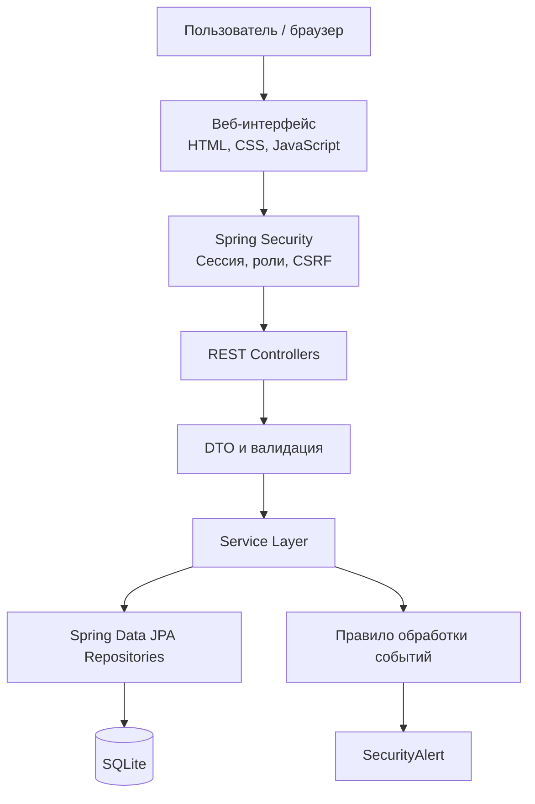
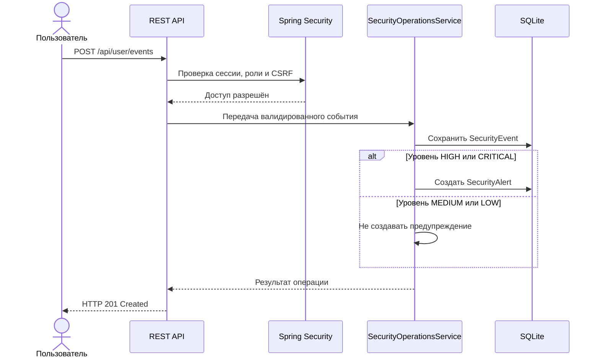
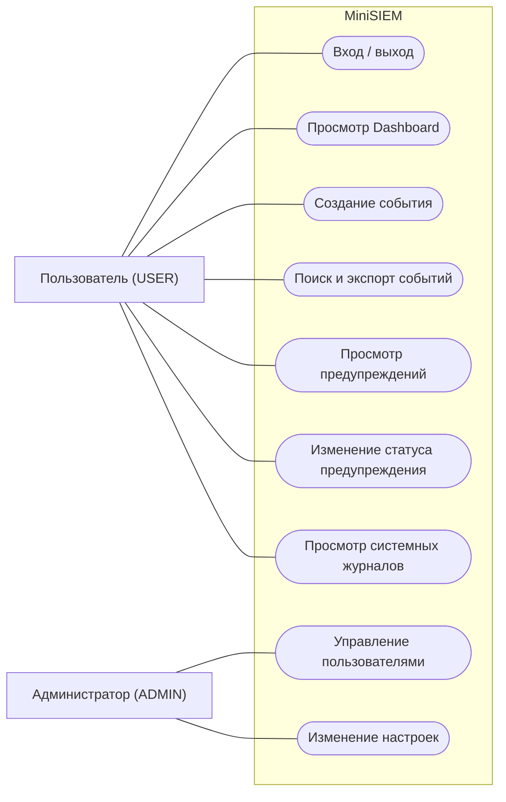
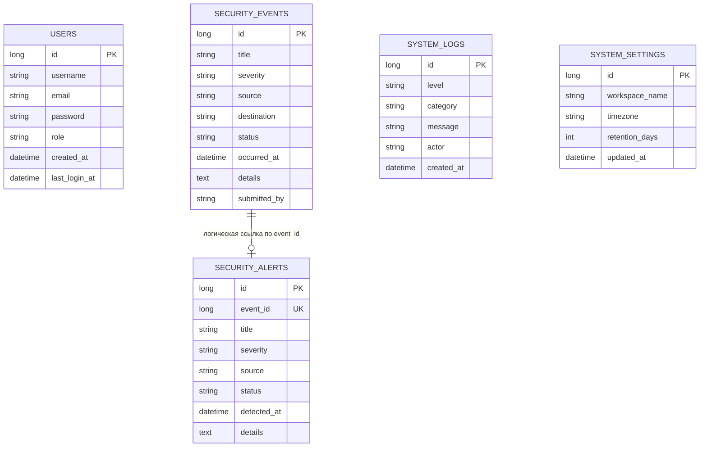

# Mini-SIEM
### Учебная система мониторинга и управления событиями информационной безопасности

MiniSIEM — учебное веб-приложение, демонстрирующее базовые принципы SIEM (Security Information and Event Management): регистрацию событий безопасности, их хранение и просмотр, автоматическое формирование предупреждений по событиям высокой критичности, управление предупреждениями и разграничение доступа пользователей.

Проект разработан в учебных целях на Java с использованием Spring Boot. Он показывает, как можно построить простой цикл обработки события безопасности — от получения через API до появления предупреждения в интерфейсе.

> **Статус репозитория:** данный репозиторий содержит документацию проекта. Исходный код приложения, ZIP-архив, локальная база SQLite и секреты сюда не включены.

---

## Содержание

- [О проекте](#о-проекте)
- [Основные возможности](#основные-возможности)
- [Роли пользователей](#роли-пользователей)
- [Архитектура системы](#архитектура-системы)
- [UML-диаграммы](#uml-диаграммы)
- [Технологический стек](#технологический-стек)
- [Модель данных](#модель-данных)
- [Правило формирования предупреждений](#правило-формирования-предупреждений)
- [REST API](#rest-api)
- [Безопасность](#безопасность)
- [Запуск проекта](#запуск-проекта)
- [Тестирование](#тестирование)
- [Ограничения](#ограничения-текущей-версии)
- [Планы развития](#планы-развития)
- [Документация](#документация)

---

## О проекте

В информационных системах ежедневно возникают события: успешные и неуспешные попытки входа, обращения к сервисам, подозрительная активность и другие действия. Анализ таких событий помогает специалистам замечать потенциальные угрозы и разбираться в инцидентах.

MiniSIEM объединяет события в одном интерфейсе и выделяет события с высоким уровнем критичности. В текущей реализации события поступают в приложение через REST API. После сохранения система проверяет уровень критичности и при значении `HIGH` или `CRITICAL` автоматически создаёт предупреждение.

**Цель проекта** — разработать понятный учебный прототип, на котором можно изучить основные компоненты SIEM: работу с событиями, правила формирования предупреждений, управление доступом и аудит действий.

## Основные возможности

- **Аутентификация:** регистрация, вход и выход из системы.
- **Ролевая модель:** разделение прав пользователей USER и ADMIN.
- **Панель мониторинга:** просмотр сводной информации о событиях и предупреждениях.
- **События безопасности:** создание, просмотр, поиск и фильтрация событий.
- **Пагинация:** постраничный вывод большого списка событий.
- **Экспорт:** выгрузка событий в формате CSV.
- **Предупреждения:** автоматическое создание для событий HIGH и CRITICAL.
- **Управление предупреждениями:** просмотр и изменение статуса.
- **Журнал действий:** хранение записей о предусмотренных системой операциях.
- **Администрирование:** управление пользователями и системными настройками для ADMIN.

## Роли пользователей

| Возможность | USER | ADMIN |
|---|:---:|:---:|
| Вход и выход | ✓ | ✓ |
| Просмотр панели мониторинга | ✓ | ✓ |
| Просмотр и создание событий | ✓ | ✓ |
| Поиск и фильтрация событий | ✓ | ✓ |
| Экспорт событий в CSV | ✓ | ✓ |
| Просмотр предупреждений | ✓ | ✓ |
| Изменение статуса предупреждения | ✓ | ✓ |
| Просмотр системных журналов | ✓ | ✓ |
| Управление пользователями | — | ✓ |
| Изменение системных настроек | — | ✓ |

Проверка полномочий выполняется на стороне сервера, а не только средствами интерфейса.

## Архитектура системы

Приложение использует многослойную архитектуру. Контроллеры принимают HTTP-запросы, сервисы выполняют бизнес-логику, репозитории взаимодействуют с базой данных, а Spring Security отвечает за аутентификацию и авторизацию.



### Основные компоненты

| Компонент | Назначение |
|---|---|
| `AuthController` | Регистрация, вход, выход и получение данных текущего пользователя |
| `SecurityOperationsController` | Операции с событиями, предупреждениями, журналами и настройками |
| `AuthService` | Логика регистрации и аутентификации |
| `SecurityOperationsService` | Основная логика обработки событий и предупреждений |
| `SecurityConfig` | Конфигурация Spring Security, сессий, CSRF и ролей |
| `UserRepository` | Доступ к данным пользователей |
| `SecurityEventRepository` | Доступ к событиям безопасности |
| `SecurityAlertRepository` | Доступ к предупреждениям |
| `SystemLogRepository` | Доступ к системным журналам |
| `SystemSettingsRepository` | Доступ к настройкам системы |

### Поток обработки события



## UML-диаграммы

Ниже представлены основные UML-модели системы. Полные исходники диаграмм в PlantUML доступны в каталоге [docs/UML](docs/UML/).

### 1. Диаграмма вариантов использования (Use Case)

Пользователь может работать с событиями, предупреждениями и журналами. Администратор дополнительно управляет учётными записями и настройками.



### 2. Диаграмма сущностей (ER-модель)



> Примечание: `SecurityAlert.eventId` — уникальное поле-идентификатор события. В текущем коде оно не оформлено как ORM-связь JPA `@OneToOne`. Диаграмма показывает логическую связь данных.

### 3. Полный комплект диаграмм

| Диаграмма | Описание | Исходник |
|---|---|---|
| Use Case | Взаимодействие USER и ADMIN с системой | [use-case.puml](docs/UML/use-case.puml) |
| Component | Компоненты и связи между слоями | [component.puml](docs/UML/component.puml) |
| Class Diagram | Основные классы и зависимости | [class-model.puml](docs/UML/class-model.puml) |
| Sequence — Authentication | Сценарий входа пользователя | [sequence-auth.puml](docs/UML/sequence-auth.puml) |
| Sequence — Event Processing | Обработка события и создание предупреждения | [sequence-event-processing.puml](docs/UML/sequence-event-processing.puml) |
| Activity | Алгоритм проверки критичности события | [activity-alert-rule.puml](docs/UML/activity-alert-rule.puml) |
| Deployment | Схема локального развёртывания | [deployment.puml](docs/UML/deployment.puml) |
| ER Diagram | Логическая модель хранения данных | [er-diagram.puml](docs/UML/er-diagram.puml) |
| State Diagram | Жизненный цикл предупреждения | [alert-state.puml](docs/UML/alert-state.puml) |

## Технологический стек

| Технология | Использование |
|---|---|
| Java 25 | Основной язык программирования |
| Spring Boot 4.1.2 | Основа серверного приложения |
| Spring Web MVC | Обработка HTTP-запросов и REST API |
| Spring Security | Аутентификация, авторизация, сессии и CSRF |
| Spring Data JPA | Доступ к данным |
| Hibernate | ORM |
| SQLite | Реляционная база данных |
| Maven Wrapper | Сборка проекта |
| HTML / CSS / JavaScript | Клиентская часть |
| JUnit 5 / Spring Test | Автоматизированные тесты |

## Модель данных

В системе используются пять основных сущностей:

| Сущность | Назначение |
|---|---|
| `User` | Учётная запись, хеш пароля и роль пользователя |
| `SecurityEvent` | Событие безопасности, его источник, назначение, критичность и время |
| `SecurityAlert` | Предупреждение, созданное на основании события |
| `SystemLog` | Запись о предусмотренном системой действии |
| `SystemSettings` | Настройки рабочей области |

## Правило формирования предупреждений

В текущей версии используется простое правило на основе уровня критичности события:

| Severity | Автоматическое предупреждение |
|---|---|
| CRITICAL | Создаётся |
| HIGH | Создаётся |
| MEDIUM | Не создаётся |
| LOW | Не создаётся |

Статусы предупреждения: `OPEN`, `INVESTIGATING`, `RESOLVED`.

Это базовое правило обработки, а не полноценная корреляция событий или автоматическое обнаружение всех видов атак.

## REST API

Основные маршруты приложения:

### Аутентификация
| Метод | Endpoint | Назначение |
|---|---|---|
| GET | `/api/auth/csrf` | Получение CSRF-токена |
| POST | `/api/auth/register` | Регистрация |
| POST | `/api/auth/login` | Вход |
| POST | `/api/auth/logout` | Выход |
| POST | `/api/auth/bootstrap-admin` | Первоначальная настройка администратора |
| GET | `/api/auth/me` | Данные текущего пользователя |

### Операции пользователя (USER и ADMIN)
| Метод | Endpoint | Назначение |
|---|---|---|
| GET | `/api/user/dashboard` | Данные панели мониторинга |
| GET | `/api/user/events` | Список событий |
| POST | `/api/user/events` | Создание события |
| GET | `/api/user/events/export` | Экспорт событий в CSV |
| GET | `/api/user/alerts` | Список предупреждений |
| GET | `/api/user/alerts/{id}` | Просмотр предупреждения |
| PATCH | `/api/user/alerts/{id}` | Изменение статуса предупреждения |
| GET | `/api/user/logs` | Список системных журналов |

### Администрирование (ADMIN)
| Метод | Endpoint | Назначение |
|---|---|---|
| GET | `/api/admin/users` | Список пользователей |
| POST | `/api/admin/users` | Создание пользователя |
| DELETE | `/api/admin/users/{id}` | Удаление пользователя |
| GET | `/api/admin/settings` | Получение настроек |
| PUT | `/api/admin/settings` | Обновление настроек |

Для защищённых маршрутов требуется аутентифицированная сессия. Изменяющие запросы должны передавать корректный CSRF-токен.

## Безопасность

В проекте реализованы следующие механизмы:

- хеширование паролей с помощью BCrypt;
- аутентификация и авторизация на основе Spring Security;
- роли USER и ADMIN;
- сессионная модель входа;
- CSRF-защита;
- ограничение доступа к административным операциям;
- специальный bootstrap-токен для первоначального создания администратора;
- защита от удаления последнего администратора и самоуничтожения учётной записи администратором.

Bootstrap-секрет должен задаваться через переменную окружения `MINISIEM_ADMIN_BOOTSTRAP_TOKEN` и не должен попадать в Git-репозиторий.

## Запуск проекта

Для запуска самого приложения необходимы исходный код проекта и установленный JDK 25. В этом репозитории исходный код намеренно не хранится.

После получения исходников:

1. Установить JDK 25.
2. Открыть корневую папку приложения, где находится `pom.xml`.
3. При необходимости задать переменную окружения `MINISIEM_ADMIN_BOOTSTRAP_TOKEN` для первоначальной настройки администратора.
4. Запустить приложение через Maven Wrapper:

**Windows**
```powershell
.\mvnw.cmd spring-boot:run
```

**Linux / macOS**
```bash
./mvnw spring-boot:run
```

5. Открыть в браузере адрес `http://localhost:8080`.

SQLite-файл создаётся локально согласно настройкам приложения. Не следует добавлять рабочую базу данных или секреты в публичный репозиторий.

## Тестирование

В проекте предусмотрены тесты JUnit 5 и Spring Test. В ранее зафиксированном локальном прогоне было успешно выполнено 23 теста: 0 ошибок, 0 пропусков. Перед окончательной сдачей рекомендуется повторить тесты на JDK 25:

**Windows**
```powershell
.\mvnw.cmd clean test
```

**Linux / macOS**
```bash
./mvnw clean test
```

Тесты охватывают регистрацию и вход, первоначальную настройку администратора, ролевой доступ, CSRF, работу с событиями, автоматическое создание предупреждений, статусы предупреждений и административные операции.

## Ограничения текущей версии

MiniSIEM является учебным прототипом и не позиционируется как готовая промышленная SIEM-платформа.

- События поступают через REST API; сбор журналов агентами с конечных устройств не подтверждён.
- Нет подтверждённой интеграции с полноценными Syslog-концентраторами.
- Правило формирования предупреждения основано на severity; сложная корреляция не реализована.
- Поведенческая аналитика и машинное обучение не реализованы.
- Настройка `retentionDays` сохраняется, но автоматическое удаление старых данных не подтверждено.
- SQLite используется как локальное хранилище прототипа.
- Нагрузочное тестирование и независимый аудит безопасности не проводились в рамках имеющихся результатов.

## Планы развития

- Поддержка Syslog и агентов сбора событий.
- Нормализация событий из разных источников.
- Настраиваемые корреляционные правила.
- Обнаружение подозрительных последовательностей входа и сетевой активности.
- Уведомления о критических предупреждениях.
- Переход на PostgreSQL для расширенных сценариев эксплуатации.
- Автоматическое архивирование и очистка по политике хранения.
- Резервное копирование и восстановление.
- Нагрузочное тестирование и расширенная проверка безопасности.

## Документация

- [Исследовательская работа](docs/Research/Research.md)
- [Архитектура системы](docs/Architecture.md)
- [Требования и тестирование](docs/Requirements-and-Testing.md)
- [Каталог UML-диаграмм](docs/UML/README.md)

---

**MiniSIEM — учебный проект по разработке информационной системы мониторинга событий безопасности.**
