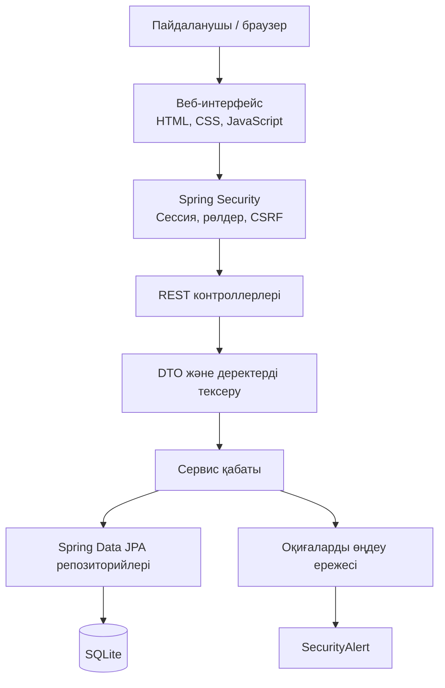
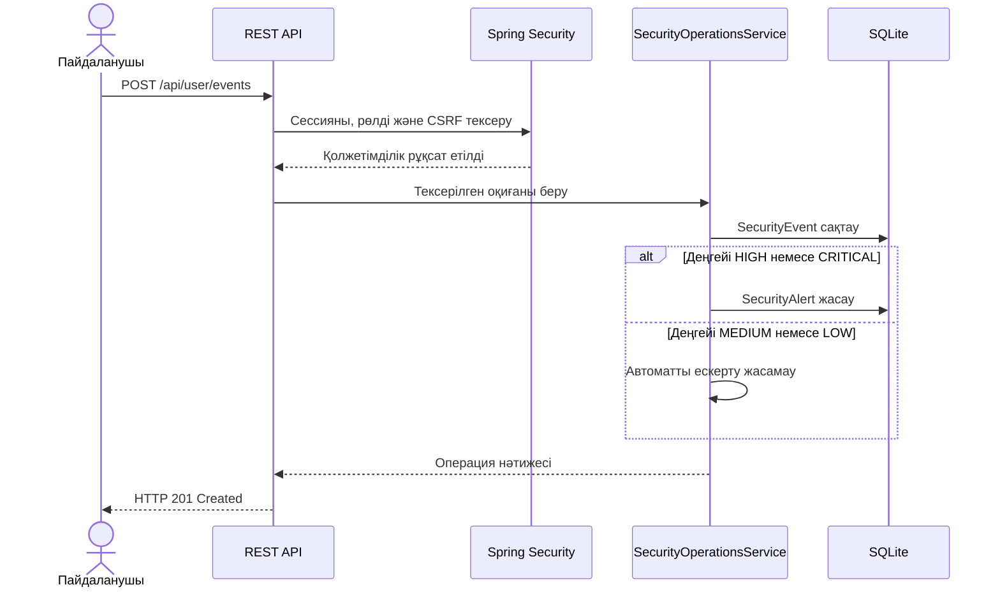
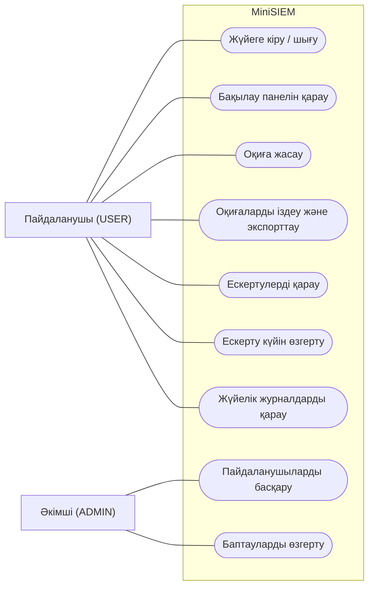
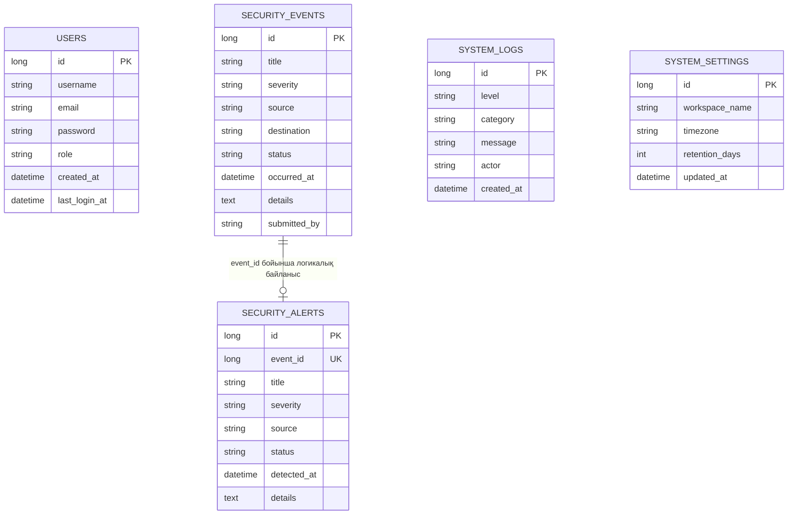

# Mini-SIEM
### Ақпараттық қауіпсіздік оқиғаларын бақылау және басқару жүйесінің оқу нұсқасы

Mini-SIEM — SIEM (Security Information and Event Management) жүйелерінің негізгі қағидаларын көрсететін оқу веб-қосымшасы. Ол қауіпсіздік оқиғаларын тіркеуге, сақтауға және қарауға, жоғары қауіпті оқиғалар бойынша ескертулерді автоматты түрде қалыптастыруға, ескертулерді басқаруға және пайдаланушылардың қолжетімділік құқықтарын бөлуге арналған.

---

## Мазмұны

- [Жоба туралы](#жоба-туралы)
- [Жоба шешетін мәселе](#жоба-шешетін-мәселе)
- [Жобаның мақсаты](#жобаның-мақсаты)
- [Жобаның міндеттері](#жобаның-міндеттері)
- [Негізгі мүмкіндіктер](#негізгі-мүмкіндіктер)
- [Пайдаланушы рөлдері](#пайдаланушы-рөлдері)
- [Жүйе архитектурасы](#жүйе-архитектурасы)
- [UML диаграммалары](#uml-диаграммалары)
- [Технологиялық құралдар](#технологиялық-құралдар)
- [Деректер моделі](#деректер-моделі)
- [Ескерту қалыптастыру ережесі](#ескерту-қалыптастыру-ережесі)
- [REST API](#rest-api)
- [Қауіпсіздік](#қауіпсіздік)
- [Жобаны іске қосу](#жобаны-іске-қосу)
- [Тестілеу](#тестілеу)
- [Қазіргі нұсқаның шектеулері](#қазіргі-нұсқаның-шектеулері)
- [Дамыту жоспарлары](#дамыту-жоспарлары)
- [Құжаттама](#құжаттама)

---

## Жоба туралы

Ақпараттық жүйелерде күн сайын әртүрлі оқиғалар орын алады: жүйеге сәтті және сәтсіз кіру әрекеттері, сервистерге сұраныстар, күдікті белсенділік және басқа да әрекеттер. Осындай оқиғаларды талдау мамандарға ықтимал қауіптерді байқауға және қауіпсіздік оқиғаларын зерттеуге көмектеседі.

Mini-SIEM оқиғаларды бір интерфейске біріктіріп, қауіптілік деңгейі жоғары оқиғаларды ерекшелейді. Қазіргі нұсқада оқиғалар қосымшаға REST API арқылы жіберіледі. Оқиға сақталғаннан кейін жүйе оның қауіптілік деңгейін тексереді. Егер деңгейі `HIGH` немесе `CRITICAL` болса, автоматты түрде ескерту жасалады.

Жоба SIEM жүйесінің оқу прототипі ретінде әзірленуде. Ол қауіпсіздік оқиғаларын қабылдау мен өңдеуді, ықтимал қауіпті жағдайларды ерекшелеуді және оларды талдауға арналған құралдарды тәжірибе жүзінде үйренуге мүмкіндік береді.

## Жоба шешетін мәселе

Көптеген ақпараттық жүйелерде қауіпсіздік оқиғалары әртүрлі журналдарда сақталады және оларды бір жерден талдауға ыңғайсыз болуы мүмкін. Журналдарды қолмен қарау маманға күдікті белсенділікті жылдам байқауды, оқиғаның маңызын анықтауды және ықтимал инцидентті өткізіп алмауды қиындатады.

Mini-SIEM осы мәселені оқу прототипі аясында шешуге бағытталған: жүйе оқиғаларды бір интерфейске біріктіреді, оларды іздеуге және сүзуге мүмкіндік береді, қауіптілік деңгейі жоғары оқиғаларды автоматты түрде ерекшелейді және кейін қарау үшін ескертулер қалыптастырады.

Маңызды: қазіргі нұсқа оқиғаларды REST API арқылы қабылдайды. Барлық құрылғылардан журналдарды автоматты жинау және өндірістік деңгейдегі толық оқиғалар корреляциясы әзірге іске асырылмаған; олар болашақтағы даму бағыттары болып саналады.

## Жобаның мақсаты

**Жобаның мақсаты** — ақпараттық қауіпсіздік оқиғаларын тіркеуге, сақтауға және талдауға, қауіптілік деңгейі жоғары оқиғалар бойынша ескертулерді автоматты түрде қалыптастыруға және пайдаланушыларға осы оқиғаларды бақылауға ыңғайлы интерфейс ұсынуға арналған оқу жүйесін әзірлеу.

## Жобаның міндеттері

1. SIEM жүйелерінің мақсатын және ақпараттық қауіпсіздік оқиғаларын бақылау қағидаларын зерттеу.
2. Қосымшаның архитектурасын жобалап, жүйенің негізгі құрамдастарын анықтау.
3. Қауіпсіздік оқиғаларын тіркеу және сақтау механизмін әзірлеу.
4. Оқиғаларды қарау, іздеу, сүзу және экспорттау мүмкіндіктерін іске асыру.
5. Қауіптілік деңгейі `HIGH` және `CRITICAL` оқиғалар үшін ескертуді автоматты қалыптастыру ережесін әзірлеу.
6. Ескертулерді басқару және олардың күйлерін өзгерту мүмкіндігін іске асыру.
7. `USER` және `ADMIN` рөлдері негізінде қолжетімділік құқықтарын бөлу.
8. Жүйеде қарастырылған әрекеттерді журналға тіркеуді қамтамасыз ету.
9. Оқиғалар мен ескертулер туралы негізгі ақпаратты көрсететін бақылау панелін жасау.
10. Қосымшаның жұмысын автоматтандырылған тесттермен тексеріп, техникалық құжаттама дайындау.

## Негізгі мүмкіндіктер

- **Аутентификация:** тіркелу, жүйеге кіру және жүйеден шығу.
- **Рөлдік модель:** USER және ADMIN пайдаланушыларының құқықтарын бөлу.
- **Бақылау панелі:** оқиғалар мен ескертулер туралы жинақталған ақпаратты қарау.
- **Қауіпсіздік оқиғалары:** оқиғаларды жасау, қарау, іздеу және сүзу.
- **Беттеу:** оқиғалардың үлкен тізімін беттерге бөліп көрсету.
- **Экспорт:** оқиғаларды CSV пішіміне шығару.
- **Ескертулер:** HIGH және CRITICAL оқиғалары үшін автоматты түрде жасау.
- **Ескертулерді басқару:** оларды қарау және күйін өзгерту.
- **Әрекеттер журналы:** жүйеде қарастырылған операциялар туралы жазбаларды сақтау.
- **Әкімшілендіру:** ADMIN үшін пайдаланушылар мен жүйе баптауларын басқару.

## Пайдаланушы рөлдері

| Мүмкіндік | USER | ADMIN |
|---|:---:|:---:|
| Жүйеге кіру және шығу | ✓ | ✓ |
| Бақылау панелін қарау | ✓ | ✓ |
| Оқиғаларды қарау және жасау | ✓ | ✓ |
| Оқиғаларды іздеу және сүзу | ✓ | ✓ |
| Оқиғаларды CSV форматына экспорттау | ✓ | ✓ |
| Ескертулерді қарау | ✓ | ✓ |
| Ескерту күйін өзгерту | ✓ | ✓ |
| Жүйелік журналдарды қарау | ✓ | ✓ |
| Пайдаланушыларды басқару | — | ✓ |
| Жүйе баптауларын өзгерту | — | ✓ |

Құқықтарды тексеру тек интерфейс деңгейінде емес, сервер жағында орындалады.

## Жүйе архитектурасы

Қосымша көпқабатты архитектураны пайдаланады. Контроллерлер HTTP сұраныстарын қабылдайды, сервистер бизнес-логиканы орындайды, репозиторийлер дерекқормен жұмыс істейді, ал Spring Security аутентификация мен авторизацияға жауап береді.



### Негізгі құрамдастар

| Құрамдас | Міндеті |
|---|---|
| `AuthController` | Тіркелу, жүйеге кіру, шығу және ағымдағы пайдаланушы деректерін алу |
| `SecurityOperationsController` | Оқиғалармен, ескертулермен, журналдармен және баптаулармен жұмыс |
| `AuthService` | Тіркелу мен аутентификация логикасы |
| `SecurityOperationsService` | Оқиғалар мен ескертулерді өңдеудің негізгі логикасы |
| `SecurityConfig` | Spring Security, сессиялар, CSRF және рөлдер баптаулары |
| `UserRepository` | Пайдаланушылар деректеріне қол жеткізу |
| `SecurityEventRepository` | Қауіпсіздік оқиғаларына қол жеткізу |
| `SecurityAlertRepository` | Ескертулерге қол жеткізу |
| `SystemLogRepository` | Жүйелік журналдарға қол жеткізу |
| `SystemSettingsRepository` | Жүйе баптауларына қол жеткізу |

### Оқиғаны өңдеу ағыны



## UML диаграммалары

Төменде жүйенің негізгі UML модельдері берілген. PlantUML диаграммаларының бастапқы файлдары [docs/UML](docs/UML/) каталогында орналасқан.

### 1. Қолдану нұсқаларының диаграммасы (Use Case)

Пайдаланушы оқиғалармен, ескертулермен және журналдармен жұмыс істей алады. Әкімші бұған қоса пайдаланушы тіркелгілері мен баптауларды басқарады.



### 2. Нысандар арасындағы байланыс диаграммасы (ER-модель)



> Ескерту: `SecurityAlert.eventId` — оқиғаның бірегей идентификатор өрісі. Қазіргі кодта ол JPA `@OneToOne` ORM байланысы ретінде рәсімделмеген. Диаграмма деректер арасындағы логикалық байланысты көрсетеді.

### 3. Диаграммалардың толық жинағы

| Диаграмма | Сипаттамасы | Бастапқы файл |
|---|---|---|
| Use Case | USER және ADMIN рөлдерінің жүйемен әрекеттесуі | [use-case.puml](docs/UML/use-case.puml) |
| Component | Құрамдастар мен қабаттар арасындағы байланыс | [component.puml](docs/UML/component.puml) |
| Class Diagram | Негізгі кластар мен тәуелділіктер | [class-model.puml](docs/UML/class-model.puml) |
| Sequence — Authentication | Пайдаланушының жүйеге кіру сценарийі | [sequence-auth.puml](docs/UML/sequence-auth.puml) |
| Sequence — Event Processing | Оқиғаны өңдеу және ескерту жасау | [sequence-event-processing.puml](docs/UML/sequence-event-processing.puml) |
| Activity | Ескерту ережесі бойынша қауіптілік деңгейін тексеру алгоритмі | [activity-alert-rule.puml](docs/UML/activity-alert-rule.puml) |
| Deployment | Жүйені жергілікті іске қосу сызбасы | [deployment.puml](docs/UML/deployment.puml) |
| ER Diagram | Деректерді сақтаудың логикалық моделі | [er-diagram.puml](docs/UML/er-diagram.puml) |
| State Diagram | Ескертудің өмірлік циклі | [alert-state.puml](docs/UML/alert-state.puml) |

## Технологиялық құралдар

| Технология | Жобада қолданылуы |
|---|---|
| Java 25 | Негізгі бағдарламалау тілі |
| Spring Boot 4.1.2 | Серверлік қосымшаның негізі |
| Spring Web MVC | HTTP сұраныстарын және REST API өңдеу |
| Spring Security | Аутентификация, авторизация, сессиялар және CSRF |
| Spring Data JPA | Деректерге қол жеткізу |
| Hibernate | ORM |
| SQLite | Реляциялық дерекқор |
| Maven Wrapper | Жобаны жинақтау |
| HTML / CSS / JavaScript | Клиенттік бөлік |
| JUnit 5 / Spring Test | Автоматтандырылған тесттер |

## Деректер моделі

Жүйеде бес негізгі нысан қолданылады:

| Нысан | Міндеті |
|---|---|
| `User` | Пайдаланушы тіркелгісі, пароль хеші және рөлі |
| `SecurityEvent` | Қауіпсіздік оқиғасы, оның көзі, нысанасы, қауіптілік деңгейі және уақыты |
| `SecurityAlert` | Оқиға негізінде жасалған ескерту |
| `SystemLog` | Жүйеде қарастырылған әрекет туралы жазба |
| `SystemSettings` | Жұмыс кеңістігінің баптаулары |

## Ескерту қалыптастыру ережесі

Қазіргі нұсқада оқиғаның қауіптілік деңгейіне негізделген қарапайым ереже қолданылады:

| Severity | Автоматты ескерту |
|---|---|
| CRITICAL | Жасалады |
| HIGH | Жасалады |
| MEDIUM | Жасалмайды |
| LOW | Жасалмайды |

Ескерту күйлері: `OPEN`, `INVESTIGATING`, `RESOLVED`.

Бұл — оқиғаларды өңдеудің негізгі ережесі. Ол толыққанды оқиғалар корреляциясы немесе шабуылдардың барлық түрін автоматты анықтау механизмі емес.

## REST API

Қосымшаның негізгі маршруттары:

### Аутентификация
| Әдіс | Endpoint | Міндеті |
|---|---|---|
| GET | `/api/auth/csrf` | CSRF токенін алу |
| POST | `/api/auth/register` | Тіркелу |
| POST | `/api/auth/login` | Жүйеге кіру |
| POST | `/api/auth/logout` | Жүйеден шығу |
| POST | `/api/auth/bootstrap-admin` | Әкімшіні бастапқы баптау |
| GET | `/api/auth/me` | Ағымдағы пайдаланушы деректері |

### Пайдаланушы операциялары (USER және ADMIN)
| Әдіс | Endpoint | Міндеті |
|---|---|---|
| GET | `/api/user/dashboard` | Бақылау панелінің деректері |
| GET | `/api/user/events` | Оқиғалар тізімі |
| POST | `/api/user/events` | Оқиға жасау |
| GET | `/api/user/events/export` | Оқиғаларды CSV форматына экспорттау |
| GET | `/api/user/alerts` | Ескертулер тізімі |
| GET | `/api/user/alerts/{id}` | Ескертуді қарау |
| PATCH | `/api/user/alerts/{id}` | Ескерту күйін өзгерту |
| GET | `/api/user/logs` | Жүйелік журналдар тізімі |

### Әкімшілендіру (ADMIN)
| Әдіс | Endpoint | Міндеті |
|---|---|---|
| GET | `/api/admin/users` | Пайдаланушылар тізімі |
| POST | `/api/admin/users` | Пайдаланушы жасау |
| DELETE | `/api/admin/users/{id}` | Пайдаланушыны жою |
| GET | `/api/admin/settings` | Баптауларды алу |
| PUT | `/api/admin/settings` | Баптауларды жаңарту |

Қорғалған маршруттар үшін аутентификациядан өткен сессия қажет. Деректерді өзгертетін сұраныстар дұрыс CSRF токенін жіберуі керек.

## Қауіпсіздік

Жобада келесі механизмдер іске асырылған:

- BCrypt көмегімен парольдерді хештеу;
- Spring Security негізіндегі аутентификация және авторизация;
- USER және ADMIN рөлдері;
- сессия арқылы жүйеге кіру;
- CSRF қорғанысы;
- әкімшілік операцияларға қолжетімділікті шектеу;
- әкімшіні бастапқы жасауға арналған арнайы bootstrap токені;
- соңғы әкімшіні жоюдан және әкімшінің өз тіркелгісін жоюынан қорғау.

Bootstrap құпия токені `MINISIEM_ADMIN_BOOTSTRAP_TOKEN` орта айнымалысы арқылы берілуі керек және Git репозиторийіне қосылмауы тиіс.

## Жобаны іске қосу

Қосымшаны іске қосу үшін бастапқы код және орнатылған JDK 25 қажет. Бұл репозиторийде қосымшаның бастапқы коды әдейі сақталмаған.

Бастапқы кодты алғаннан кейін:

1. JDK 25 орнату.
2. `pom.xml` орналасқан қосымшаның негізгі бумасын ашу.
3. Қажет болса, әкімшіні бастапқы баптау үшін `MINISIEM_ADMIN_BOOTSTRAP_TOKEN` орта айнымалысын орнату.
4. Қосымшаны Maven Wrapper арқылы іске қосу:

**Windows**
```powershell
.\mvnw.cmd spring-boot:run
```

**Linux / macOS**
```bash
./mvnw spring-boot:run
```

5. Браузерден `http://localhost:8080` мекенжайын ашу.

SQLite файлы қосымша баптауларына сәйкес жергілікті түрде жасалады. Жұмыс дерекқорын немесе құпия мәндерді ашық репозиторийге жүктемеу керек.

## Тестілеу

Жобада JUnit 5 және Spring Test тесттері қарастырылған. Бұрын тіркелген жергілікті іске қосу нәтижесінде 23 тест сәтті орындалған: 0 қате, 0 өткізіп жіберілген тест. Соңғы тапсыру алдында JDK 25 орнатылған мақсатты компьютерде тесттерді қайта орындау ұсынылады:

**Windows**
```powershell
.\mvnw.cmd clean test
```

**Linux / macOS**
```bash
./mvnw clean test
```

Тесттер тіркелу мен жүйеге кіруді, әкімшіні бастапқы баптауды, рөлдік қолжетімділікті, CSRF қорғанысын, оқиғалармен жұмысты, ескертулерді автоматты жасауды, ескерту күйлерін және әкімшілік операцияларды қамтиды.

## Қазіргі нұсқаның шектеулері

MiniSIEM — оқу прототипі. Ол өндірістік ортаға арналған дайын SIEM платформасы ретінде ұсынылмайды.

- Оқиғалар REST API арқылы қабылданады; соңғы құрылғылардан агенттер арқылы журнал жинау расталмаған.
- Толыққанды Syslog жинақтағыштарымен интеграция расталмаған.
- Ескерту жасау ережесі severity деңгейіне негізделген; күрделі корреляция іске асырылмаған.
- Мінез-құлық талдауы және машиналық оқыту іске асырылмаған.
- `retentionDays` баптауы сақталады, бірақ ескі деректерді автоматты жою расталмаған.
- Жергілікті прототип үшін SQLite қолданылады.
- Қолда бар нәтижелерде жүктемелік тестілеу және тәуелсіз қауіпсіздік аудиті жүргізілгені көрсетілмеген.

## Дамыту жоспарлары

- Syslog және оқиғаларды жинау агенттерін қолдау.
- Әртүрлі көздерден келген оқиғаларды бірыңғай пішімге келтіру.
- Бапталатын корреляция ережелерін қосу.
- Қайталанатын кіру әрекеттері мен күдікті желілік белсенділікті анықтау.
- Қауіпті ескертулер туралы хабарландырулар жіберу.
- Кеңейтілген пайдалану сценарийлері үшін PostgreSQL-ге көшу.
- Сақтау саясаты бойынша деректерді мұрағаттау және автоматты тазалау.
- Сақтық көшірме жасау және қалпына келтіру.
- Жүктемелік тестілеу және қауіпсіздікті кеңейтілген тексеру.

## Құжаттама

- [Зерттеу жұмысы](docs/Research/Research.md)
- [Жүйе архитектурасы](docs/Architecture.md)
- [Талаптар және тестілеу](docs/Requirements-and-Testing.md)
- [UML диаграммаларының каталогы](docs/UML/README.md)

---

**MiniSIEM — қауіпсіздік оқиғаларын бақылауға арналған ақпараттық жүйені әзірлеу бойынша оқу жобасы.**
